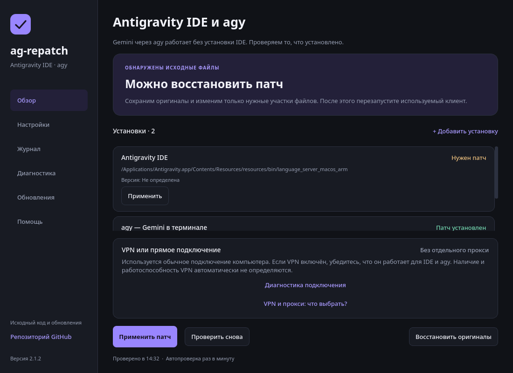

# ag-repatch

**Восстановить патч Antigravity IDE или `agy` после обновления — в несколько нажатий.**

Приложение находит установленный клиент, сохраняет резервную копию и повторно применяет локальный патч. Для отдельного `agy` установка IDE не нужна.

Windows · macOS · Linux · русский и английский интерфейс

## Скачать

[Все готовые сборки →](https://github.com/etosheartem/ag-repatch/releases/latest)

| Система | Скачать | Запуск |
|---|---|---|
| Windows x64 | [`.exe`](https://github.com/etosheartem/ag-repatch/releases/latest/download/ag-repatch-windows-x64.exe) | Откройте скачанный файл |
| macOS, Apple Silicon | [`.dmg`](https://github.com/etosheartem/ag-repatch/releases/latest/download/ag-repatch-macos-arm64.dmg) | Перенесите приложение в «Программы» |
| macOS, Intel | [`.dmg`](https://github.com/etosheartem/ag-repatch/releases/latest/download/ag-repatch-macos-x64.dmg) | Перенесите приложение в «Программы» |
| Linux x64, Ubuntu 22.04+ | [AppImage](https://github.com/etosheartem/ag-repatch/releases/latest/download/ag-repatch-linux-x64.AppImage) | Разрешите запуск файла в его свойствах |
| Linux без FUSE | [`.tar.gz`](https://github.com/etosheartem/ag-repatch/releases/latest/download/ag-repatch-linux-x64.tar.gz) | Распакуйте и откройте `ag-repatch`, сохранив рядом остальные файлы |

Python и сборка из исходников не нужны. Linux требует glibc 2.35+. Сборки пока без доверенной подписи издателя и нотариализации Apple.

## У меня VPN. Нужен ли ещё прокси?

**Обычно нет, если VPN действительно проводит трафик IDE или `agy`.** В ag-repatch оставьте **«Использовать отдельный HTTP-прокси» выключенным**. Это настройка по умолчанию для новых установок.

| Ваш случай | Что выбрать |
|---|---|
| IDE/agy работают через системный VPN или режим TUN | Отдельный прокси выключен |
| Доступ есть без VPN | Отдельный прокси выключен |
| Есть работающий HTTP-прокси, который хотите использовать для IDE/agy | Включите отдельный прокси и скопируйте его адрес из прокси-клиента |
| VPN-клиент работает только в режиме «системный прокси», без VPN/TUN | Укажите его HTTP-адрес как отдельный прокси либо включите VPN/TUN |
| VPN включён только в браузере | Проверьте VPN для самого IDE/agy: расширение браузера обычно не покрывает другие приложения |

При выборочном VPN включите в маршрут нужные приложения. Успех в браузере ещё не означает доступ из терминала или IDE.

**Патч и подключение решают разные задачи:** патч меняет локальные файлы, VPN или прокси обеспечивает сетевой маршрут. ag-repatch не устанавливает VPN/прокси, не меняет внешний IP и не заменяет вход в аккаунт. Если всё уже работает, применять патч не требуется.

Адрес `http://127.0.0.1:53129` в поле — **только пример**, а не встроенный прокси. `127.0.0.1` означает ваш компьютер; порт нужно взять из настроек своего клиента. Поддерживаются HTTP/HTTPS-прокси без логина и пароля; SOCKS здесь не поддерживается.

**Раньше использовали прокси, теперь хотите только VPN?** Выключите флажок, сохраните настройки и нажмите **«Убрать сохранённый прокси»**. Затем перезапустите IDE и терминал; иногда нужен повторный вход в систему. Одного выключения флажка недостаточно: старый адрес сохраняется отдельно.

## Как пользоваться

1. Установите **Antigravity IDE или отдельный [`agy`](https://www.antigravity.google/docs/cli/install/)**.
2. Откройте ag-repatch. Мастер первого запуска поможет найти установку и выбрать подключение.
3. Закройте IDE и сеансы `agy`, затем нажмите **«Применить патч»**. Оригинал сохраняется перед изменением.
4. Перезапустите IDE или откройте новый терминал и запустите `agy`. Войдите в аккаунт, если потребуется.

Не нашлась установка — нажмите **«Добавить установку»**. Нужен откат — **«Восстановить оригиналы»**. Подробные пояснения доступны в разделе **«Помощь»** самого приложения.

## Если не работает

- **«Патч установлен»** говорит о файлах, а не о доступности сервиса.
- **«Порт доступен»** говорит только о соединении с прокси. Это ещё не проверка Google или входа в аккаунт.
- Откройте **«Диагностика» → «Проверить подключение»**. Проверяется выбранный/сохранённый прокси либо обычное подключение компьютера, включая системный VPN.
- Диагностика обращается к `example.com` и API Google без учётных данных. Она не подтверждает доступ к конкретной модели; при раздельной маршрутизации путь IDE/agy может отличаться.
- Если версия файла не распознана, приложение оставляет её без изменений. Совместимость зависит от версии Antigravity.

Для разбора ошибки можно сохранить отчёт в «Диагностике». Он не включает личные пути, адрес прокси и сырой журнал; перед сохранением есть предпросмотр.

## Как выглядит

Снимок с демонстрационными данными. Ваши установки и их состояние могут отличаться.

## Обновления и подробности

Готовые обновления доступны в разделе **«Обновления»** приложения и на [странице релизов](https://github.com/etosheartem/ag-repatch/releases). Загрузка идёт с GitHub; контрольная сумма проверяется перед установкой.

Язык интерфейса следует системной локали: русский для русской, английский для остальных. Автопатч и запуск при входе включаются отдельно в настройках.

[Подробная инструкция, CLI и сборка →](README.ru.md) · [Сообщить о проблеме →](https://github.com/etosheartem/ag-repatch/issues)

Лицензия: [MIT](LICENSE).
